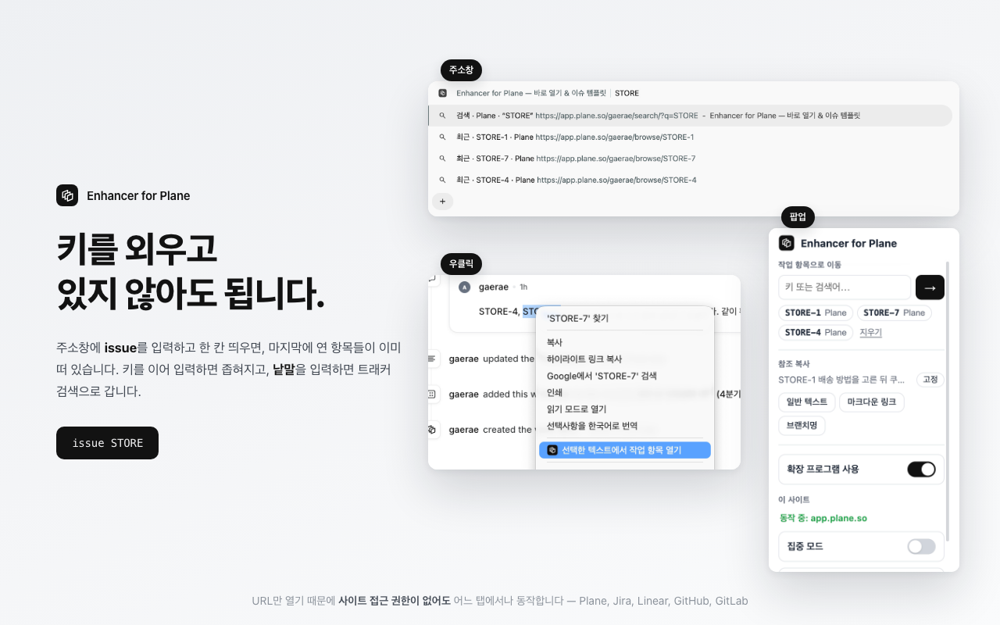
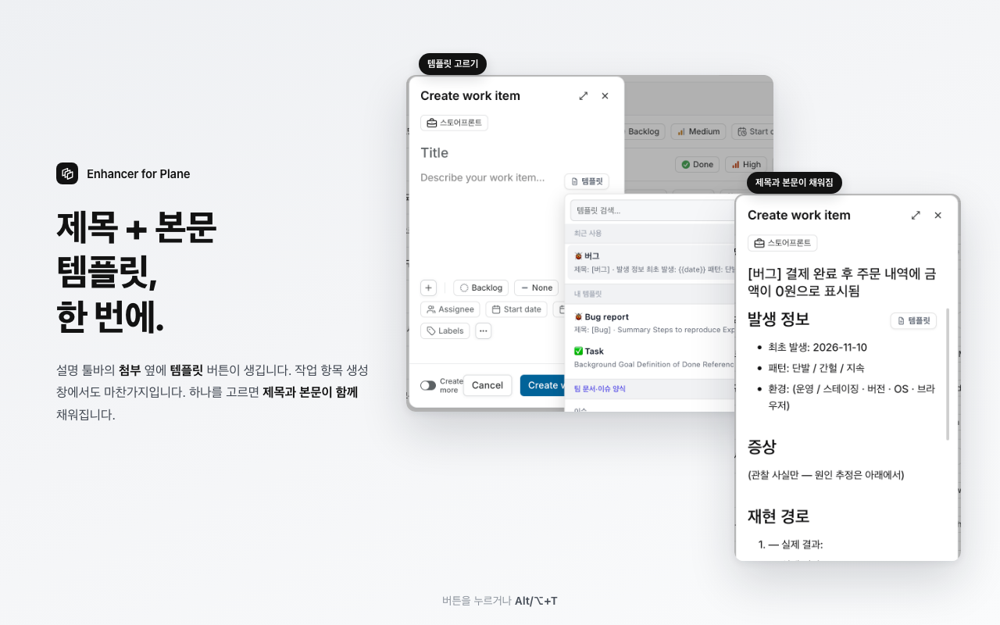
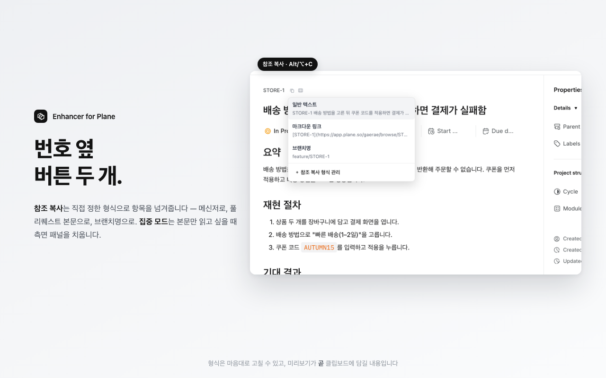
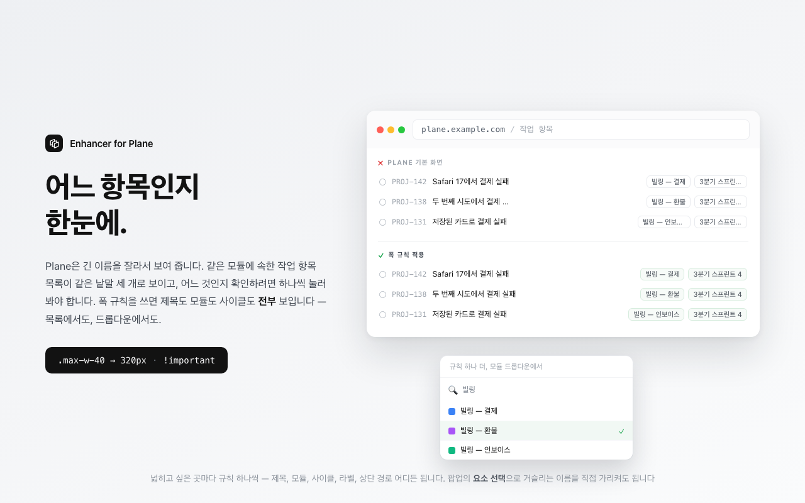
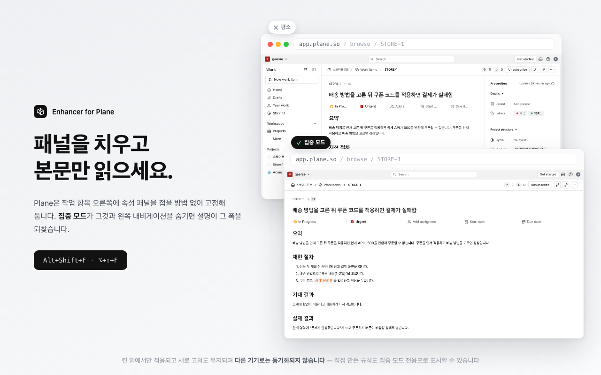

# Enhancer for Plane — 이슈 템플릿 & 바로 열기

[English](README.md) · **한국어**

새 버전은 GitHub에 먼저 올라오고, 스토어에는 며칠 걸리는 심사를 거쳐 올라옵니다.
두 배지가 다르면 실제로 설치된 것은 스토어 쪽입니다.

**➜ [Chrome 웹 스토어에서 설치](https://chromewebstore.google.com/detail/dicjfphghjfljkifogkplgdeefjdkhbo)** — 또는 [소스에서 직접 로드](#설치).

[Plane](https://github.com/makeplane/plane)(makeplane / plane.so)을 위한 가벼운
비공식 크롬 익스텐션(Manifest V3)입니다. Plane은 프로젝트 관리와 이슈, 위키를
함께 다루는 오픈소스 도구이자 Jira의 자체 호스팅 대안입니다.

반복해서 등록하는 티켓은 **이슈 템플릿**으로 한 번에 채우고, 티켓은 키만으로 **바로 열기**로
엽니다. 클릭 한 번으로 끝나는 **참조 복사**와 측면 패널을 치워 주는 **집중 모드**도 있습니다.

전부 Plane UI 안에서 동작하고, Plane 서버는 전혀 건드리지 않습니다. Plane Cloud와
자체 호스팅 모두에서 되며, 켜 둔 도메인에서만 동작합니다.

> Plane과 제휴하거나 승인받은 제품이 아닙니다. "Plane"은 해당 소유자의 상표이며,
> 본 익스텐션은 독립적인 비공식 애드온입니다. (비행기와는 무관합니다.)

## 무엇을 하고, 어디서 쓰나

| | 어디서 | 먼저 필요한 것 |
|---|---|---|
| **키로 항목 열기** | 주소창 `issue` ␣ `PROJ-123` · 툴바 팝업 · 글 속의 키를 드래그하고 우클릭 | 바로 열기 링크 1개 |
| **최근에 본 것으로 돌아가기** | 같은 두 곳 — 키워드를 입력하는 순간 뜹니다 | 없음, 알아서 쌓입니다 |
| **자주 여는 항목 고정** | 작업 항목 탭의 툴바 팝업에서 **고정** | 바로 열기 링크 1개 |
| **열지 말고 검색하기** | 주소창 `issue` ␣ `로그인 버그` | 그 링크의 검색 주소 |
| **참조 복사** | 항목 번호 옆 버튼 · <kbd>Alt</kbd>/<kbd>⌥</kbd>+<kbd>C</kbd> · 팝업 | 없음, 형식 3개 기본 제공 |
| **제목 + 본문 넣기** | 설명 툴바의 "템플릿" 버튼 · <kbd>Alt</kbd>/<kbd>⌥</kbd>+<kbd>T</kbd> | 템플릿 1개 |
| **팀과 템플릿 공유** | 설정 ▸ 템플릿 ▸ 템플릿 동기화 | JSON 주소 1개 |
| **측면 패널 숨기기** | <kbd>Alt</kbd>+<kbd>Shift</kbd>+<kbd>F</kbd> · 번호 옆 토글 · 팝업 | 없음, 프리셋 제공 |
| **잘린 이름 넓히기** | 설정 ▸ 화면 · 또는 팝업의 요소 피커 | 자체 호스팅 1.4는 없음, 프리셋 제공. Plane Cloud는 요소 피커로 한 번 지정 |

**처음 5분**

1. 설치하고 Plane 탭에서 툴바 아이콘 → **이 사이트에서 사용**. Chrome이 그 사이트 하나만
   한 번 물어봅니다. 다른 곳에서는 아무것도 실행되지 않습니다.
2. 설정 ▸ **작업 항목** ▸ **＋ 링크 추가** → 열어 둔 작업 항목의 주소를 붙여넣으세요.
   이 붙여넣기 한 번으로 열기와 검색, 복사가 모두 준비됩니다.
3. 주소창에 `issue`와 한 칸을 입력해 보세요. 나머지는 전부 선택 사항입니다.

적용 도메인도, 사이트 접근 권한도, 바로 열기 링크도 없이 배포됩니다. 직접 켜기 전까지는
아무 일도 하지 않습니다.

## 기능

### ⚡ 바로 열기

- **주소창**: `issue`, 한 칸, `PROJ-123` 같은 키 입력 후 Enter로 열림. 같은 입력칸이 툴바
  팝업에도 있음.
- **우클릭**: Slack 메시지나 PR 제목 등 어디서든 키가 든 글을 드래그 → **선택한 텍스트에서
  작업 항목 열기**. 키 10개까지, 각각 새 탭. Chrome이 선택한 텍스트만 넘겨주고 페이지는 읽지 않음.
- **링크 추가**: 작업 항목 주소를 설정 ▸ **작업 항목**에 붙여넣으면 아는 트래커는 검색 주소까지
  자동으로 채움. Plane, Jira, Linear, GitHub, GitLab 예시 줄 제공.
- **어느 트래커든 가능**: 대상은 `{{key}}`를 넣은 URL 하나(Plane은 `/{workspace}/browse/{{key}}`).
  호스트 권한 불필요. 키 접두사로 대상 선택 — `ENG-`는 Linear로, 나머지는 Plane으로.
- **최근 항목과 고정**: 최근 연 키 12개가 주소창과 팝업에 다시 나옴(**지우기**로 비움).
  **고정**은 제목과 함께 6개까지 보관. 둘 다 이 기기에만 저장됨.
- **낱말은 검색으로**: `issue login bug`는 대상의 검색 주소(`{{q}}`)로 이동. Jira와 GitHub은
  결과 화면까지, Plane은 낱말을 채운 검색 화면까지.

### 📝 본문 템플릿(제목 + 본문)

- 설명 툴바와 "신규 작업항목 생성" 창의 **"템플릿"** 버튼으로 제목과 설명을 한 번에 채움.
  <kbd>Alt</kbd>/<kbd>⌥</kbd>+<kbd>T</kbd>는 양쪽 모두에서 동작함.
- **지원하는 마크다운**: 제목, `-`/`1.` 목록, `- [ ]` 체크박스, `---`, 굵게, 기울임, 인라인 코드.
  표, 코드 펜스, 링크, 이미지, 인용문은 적은 글자 그대로 들어감.
- **삽입 시 채워지는 변수**: `{{date}}`, `{{date+N}}`/`{{date-N}}`, `{{week}}`, `{{month}}`.
- **직접 만드는 변수 5개까지**: 설정에서 `이름` → `값`을 등록하고 `{{var.이름}}`으로 씀. 공유
  템플릿도 사람마다 다른 값으로 채워지고, 등록하지 않은 이름은 토큰 그대로 남음.
- **최근 사용**: 이 기기에서 마지막으로 넣은 템플릿 3개가 긴 메뉴의 맨 위에 옴. 버튼이
  마지막으로 툴바를 찾은 때를 설정에서 보여 주고, 못 찾게 되면 그 사실도 알려 줌.

### 📋 참조 복사

- 작업 항목 번호 옆 버튼(또는 <kbd>Alt</kbd>/<kbd>⌥</kbd>+<kbd>C</kbd>)으로 그 항목을 복사함.
  항목 화면과 목록에서 열리는 패널 모두에서 동작함.
- **형식은 직접 작성**: 일반 텍스트, 마크다운 링크, 브랜치명이 편집 가능한 줄로 기본 제공됨.
  설정에서 줄마다 결과를 미리 보여 줌.
- 치환 값은 `{{item.key}}`, `{{item.title}}`, `{{item.url}}`. 페이지에서 못 읽은 값은 토큰 그대로
  남고 토스트로 알려 줌.
- **툴바 팝업에서도 가능**: 작업 항목 탭이면 탭의 주소와 제목만 읽어 복사함.
- 버튼이 마지막으로 자리를 찾은 때를 설정에서 보여 주고, 못 찾게 되면 그 사실도 알려 줌.

### 🧹 복사한 텍스트 — 줄 끝에 남는 `\`, 엑셀로 가는 표

- **줄 끝 `\` 제거**: 본문에서 복사하면 Plane이 줄바꿈을 줄 끝 백슬래시로 적는데, 그 문자만
  떼어냄. 직접 입력한 백슬래시와 코드 블록 안의 것은 그대로 둠.
- **엑셀에 표를 붙이면 셀마다 그대로 들어감**: 셀 안의 줄바꿈, 문단, 목록(`•`, `1.`, `☑`), 코드가
  행으로 쪼개지지 않고 그 셀에 남음. Word와 Google 문서에서는 셀 안의 목록과 제목이 텍스트 줄로 들어감.
- 설정할 것 없음. Plane 전용 복사 형식은 건드리지 않아 Plane에 다시 붙여넣는 동작은 그대로임.

### 📐 스타일 규칙 — 범용 엔진

- `선택자 + 속성 + 값` 규칙 하나로 원하는 폭을 지정함. 값은 단위까지 직접 씀(`320px`, `30rem`,
  `55ch`). 선택자는 입력하는 동안 검사함.
- **켜진 채로 제공**: 항목 이름 폭, 검색 드롭다운 폭, 긴 설명을 전부 보여 주는 규칙 두 개(Plane
  Cloud의 **모두 보기** 접힘 제거). 사이클과 브레드크럼 폭은 **빠른 추가**로 넣음.
- **항목 이름 폭은 양쪽에 맞음**(자체 호스팅 1.4는 `.max-w-40`, Cloud는 `max-w-[224px]`). Cloud는
  행이 충분히 넓을 때만 모듈 칩을 보여 주고, 좁으면 `+1` 버튼으로 접음.
- **규칙마다 실제로 적용되는지 표시함**: 마지막으로 적용된 시점, 또는 한 번도 못 찾았다는 사실.
  Plane 개편은 오래된 날짜 하나로 드러남.

### 🧘 집중 모드

- <kbd>Alt</kbd>+<kbd>Shift</kbd>+<kbd>F</kbd>(macOS <kbd>⌥</kbd>+<kbd>⇧</kbd>+<kbd>F</kbd>), 번호 옆 토글,
  팝업 스위치 중 하나로 측면 패널을 숨김.
- **스위치가 달린 규칙 엔진**: 어떤 규칙이든 *"집중 모드에서만 적용"*으로 표시하면 함께 동작함.
  프리셋은 속성 패널과 왼쪽 내비게이션(켜짐), 읽기 폭(꺼짐).
- **탭 단위**: 새로고침해도 유지되고 탭을 닫으면 사라짐. 동기화되지 않음.
- 브라우저 명령이라 입력 중에도 글자를 먹지 않음. `chrome://extensions/shortcuts`에서 변경
  가능하고, 설정 ▸ **단축키**에 모든 키가 정리돼 있음.

### 🎯 비주얼 요소 피커

- 팝업에서 **"요소 선택 → 규칙 추가"**를 누르고 요소를 클릭하면 매칭 개수와 함께 선택자 후보가
  나옴. 고른 것은 값만 넣으면 되는 상태로 설정에 담김.
- **다음 달에도 살아 있을 순서로 정렬**: 사람이 붙인 이름이 먼저, 해시 클래스와 uuid는 아래로.
  내리기만 하고 숨기지는 않음.
- 줄마다 이름의 종류와 **오래 감**인지 **바뀔 수 있음**인지 표시함. 뒷부분이 생성된 id에는
  `[id^="…"]` 접두사 형태도 제안함.

### 🔄 팀 템플릿 동기화

- JSON 파일 하나(사내 서버, Git 호스트, 아무 URL)를 가리키면 팀 전체가 같은 템플릿을 받음.
  기본은 꺼져 있고, 추가할 때 Chrome이 그 오리진 하나의 접근을 물음.
- **"예시 사용해 보기"**를 누르면 이 저장소의 템플릿 26개 모음을 사용 언어에 맞춰 구독함.
- 소스 10개까지, 소스마다 주기(1시간마다, 6시간마다, 12시간마다, 하루마다)와 켜기/끄기를 따로 둠. **지금 동기화**도 있음.
- **읽기 전용**: 수정은 소스에서 함. 그룹 숨기기는 로컬 설정이라 동기화 후에도 유지됨.
- 피커는 캐시만 읽고 네트워크를 쓰지 않음. 오프라인에서도 동작하고, 동기화가 실패해도 마지막
  정상본이 남음.

### 🏠 적용 도메인

- 추가한 도메인에서만 동작함. 와일드카드(`*.example.com`)와 **모든 사이트에서 실행**을 지원함.

### 💾 백업(가져오기 / 내보내기)

- 도메인, 규칙, 템플릿, 변수, 복사 형식, 바로 열기 링크, 동기화 소스를 JSON으로 내보냄. 내려받은
  템플릿과 동기화 상태는 기기별 캐시라 빠짐.
- 가져오면 폼에 로드되고 **저장**을 눌러야 적용됨.

## 팀 템플릿 파일 형식

- 중첩 없는 `templates[]` 배열 하나를 담은 JSON. 항목마다 `name`, `title`, `content`, 선택으로
  `group`과 `id`.
- 직접 쓸 필요 없음. 설정 ▸ 템플릿 ▸ 본문 템플릿 ▸ **팀에 공유**로 이 형식 그대로 내보냄.
- 필드, 제한, 리다이렉트, 예시 모음은 [examples/README.md](examples/README.md)(영문) 참고.

## 자체 호스팅 Plane과 Plane Cloud

- **자체 호스팅 Plane**용으로 만들었고, 같은 빌드가 **Plane Cloud**(`app.plane.so`)에서도 동작함.
- **기본 적용 도메인도, 호스트 접근 권한도 없음.** 사용하는 주소(예: `plane.your-company.com`,
  `app.plane.so`)를 **이 사이트에서 사용**이나 설정에서 추가하면 Chrome이 그 사이트 하나만 한 번
  물음. 다른 사이트에서는 완전히 비활성.
- 둘은 같은 화면을 다른 클래스로 그리므로, 클래스를 적은 프리셋은 한쪽에만 맞을 수 있음. 켜진
  채로 제공하는 프리셋은 양쪽을 모두 담고 있음.
- 프리셋이 놓친 것은 선택자 한 줄 수정이나 요소 피커 한 번이면 해결됨.

## 설치

**Chrome 웹 스토어에서 설치(권장)**

[Enhancer for Plane 설치](https://chromewebstore.google.com/detail/dicjfphghjfljkifogkplgdeefjdkhbo) →
툴바 아이콘 클릭 후 사용하는 Plane 인스턴스에서 **이 사이트에서 사용**.

**개발자 모드(소스에서)**

1. Chrome에서 `chrome://extensions` 접속.
2. 우측 상단 **개발자 모드** 켜기.
3. **압축해제된 확장 프로그램을 로드** → 이 프로젝트 폴더 선택.
4. 툴바 아이콘 클릭 → **설정 · 템플릿 관리**에서 도메인, 폭, 템플릿 조정.

## 권한

- `storage` — 사용자 설정 저장. 이 기기에만 남는 것: 내려받은 팀 템플릿, 최근 키, 고정 항목, 최근
  사용 템플릿, 규칙과 버튼이 마지막으로 무언가를 찾은 때.
- `alarms` — 선택한 주기마다 팀 템플릿 갱신.
- `activeTab` — 툴바 아이콘을 누른 탭의 주소와 제목을 읽음(사이트 상태, 참조 복사, 고정). 요소
  피커도 그 탭에서 시작함. **고정**을 눌렀을 때만 저장됨.
- `contextMenus` — 선택한 텍스트에만 뜨는 우클릭 메뉴 하나. 그 안의 키를 엶.
- `scripting` — 승인한 오리진에만 콘텐츠 스크립트를 실행함.
- **선택적 호스트 권한, 사이트별** — 도메인을 켜거나 동기화 소스를 추가할 때 요청하고, 지우면
  해제됨. **모든 사이트에서 실행**을 켜지 않는 한 모든 사이트 접근은 요청하지 않음.

계정, 추적, 분석, 원격 코드 모두 없음. 익스텐션이 보내는 요청은 직접 등록한 URL에서 팀 템플릿을
내려받는 것 하나뿐임. 자세한 내용은 [PRIVACY.md](PRIVACY.md) 참고.

## 제약조건

- **Chrome / Chromium, Manifest V3 전용** — Firefox와 Safari는 지원하지 않음.
- **도메인을 추가하기 전까지 비활성**(또는 **모든 사이트에서 실행**을 켰을 때만 전체 동작).
- **설명 템플릿만 지원** — 댓글 템플릿은 없음.
- **동기화된 템플릿은 읽기 전용** — 수정은 원본 파일에서 함.
- **동기화 저장소는 Chrome의 전체 ~100 KB, 항목당 ~8 KB 한도를 따름.** 글자 수가 아니라 바이트로
  셈(한글 글자당 3, 이모지 4, `<`는 6). 어느 쪽이든 넘으면 저장이 거부되고 원인을 알려 줌. 설정
  페이지에서 두 한도를 모두 보여 줌. 팀 템플릿은 `chrome.storage.local`에 저장돼 이 한도와 무관함.

  | | 100 KB에 들어가는 개수 | 템플릿 1개 최대 길이 |
  |---|---|---|
  | 영문 400자 | 약 212개 | 약 8,100자 |
  | 한글 400자 | 약 79개 | 약 2,700자 |
  | HTML 섞인 마크다운 | 약 160개 | 약 1,350자 |

## 기여

검사 도구, 파일 구성, 규칙은 [AGENTS.md](AGENTS.md) 참고. 릴리스와 스토어 등록 정보는
[store-assets/STORE_LISTING.md](store-assets/STORE_LISTING.md#packaging) 참고.

## 라이선스

[MIT](LICENSE) © 2026 gaerae
