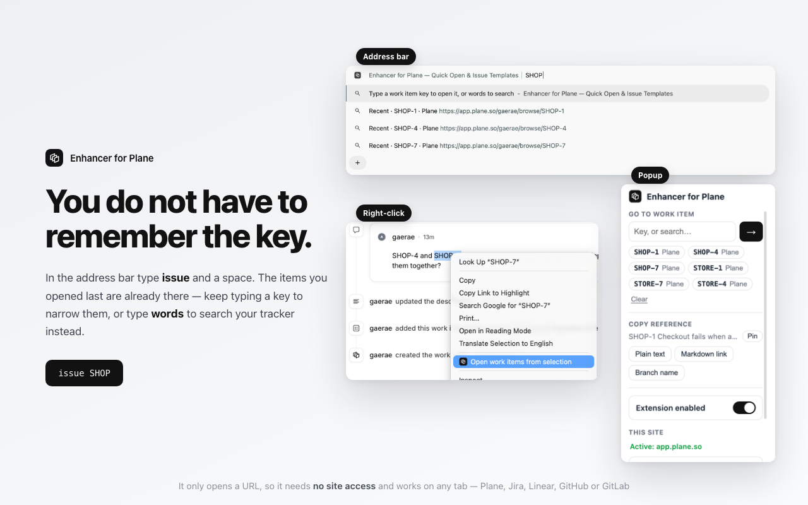
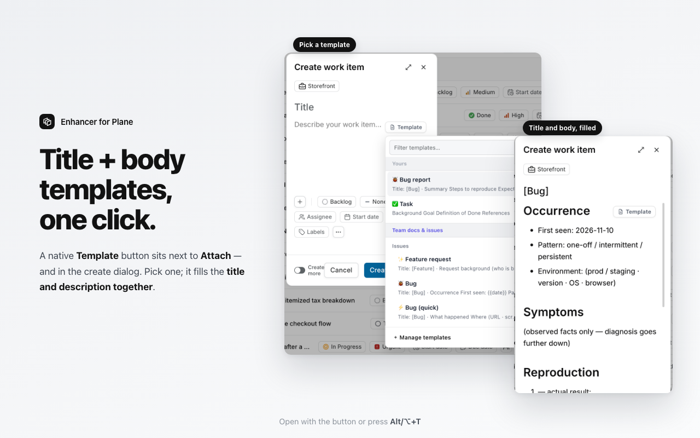
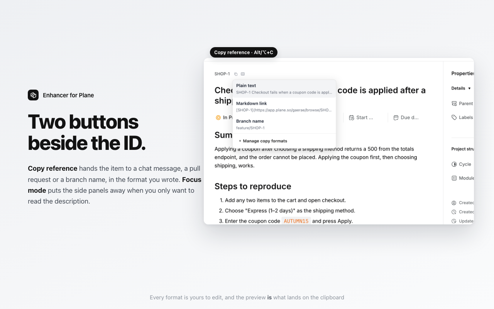
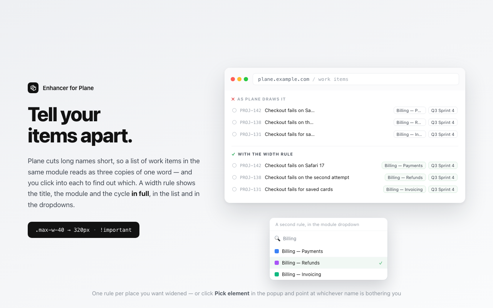
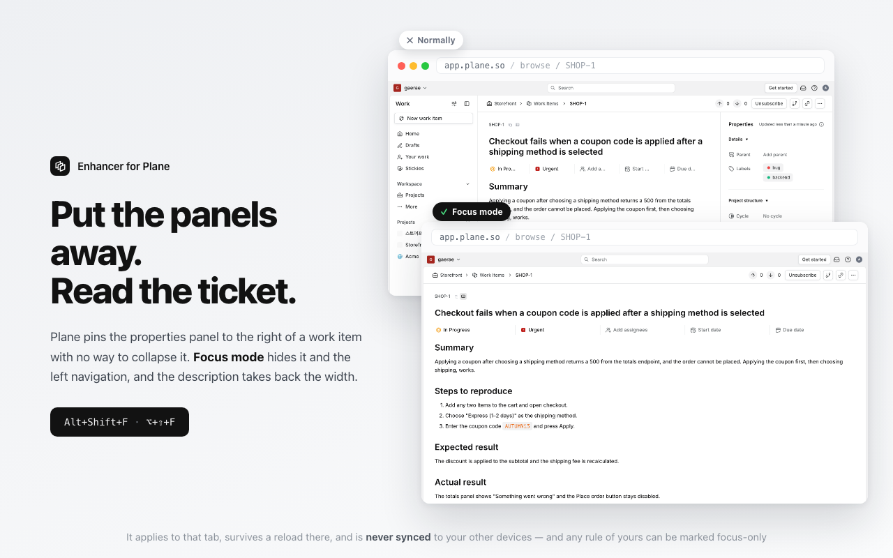

# Enhancer for Plane — Quick Open & Issue Templates

**English** · [한국어](README.ko.md)

A new version reaches GitHub first and the store after review, which takes days.
While the two badges differ, the store one is what you have installed.

**➜ [Install from the Chrome Web Store](https://chromewebstore.google.com/detail/dicjfphghjfljkifogkplgdeefjdkhbo)** — or [load unpacked from source](#install).

A lightweight, unofficial Chrome extension (Manifest V3) for
[Plane](https://github.com/makeplane/plane) (makeplane / plane.so) — the open-source project
management, issues and wiki tool, and a self-hosted alternative to Jira.

**Issue templates** for the tickets you file over and over, **quick open** to reach a ticket
from its key, a one-click **copy reference**, and a **focus mode** that puts the side panels away.

All inside the Plane UI, with no changes to your Plane server. Works on Plane Cloud and
self-hosted alike, and only on the domains you enable.

> Not affiliated with or endorsed by Plane. "Plane" is a trademark of its owner.
> (And no — nothing to do with airplanes.)

## What it does, and where you use it

| | Where you reach it | What it needs first |
|---|---|---|
| **Open an item by key** | Address bar: `issue` ␣ `PROJ-123` · toolbar popup · right-click a key in any text | one Quick open link |
| **Come back to a recent one** | Same two places — they appear the moment you type the keyword | nothing, it fills itself |
| **Keep the ones you return to** | Toolbar popup: **Pin** on a work item's tab | one Quick open link |
| **Search instead of opening** | Address bar: `issue` ␣ `login bug` | a search URL on that link |
| **Copy a reference** | The button beside the item's key · <kbd>Alt</kbd>/<kbd>⌥</kbd>+<kbd>C</kbd> · the popup | nothing, three formats ship |
| **Insert a title + body** | "Template" button in the description toolbar · <kbd>Alt</kbd>/<kbd>⌥</kbd>+<kbd>T</kbd> | one template |
| **Share templates with a team** | Settings ▸ Templates ▸ Template sync | one JSON URL |
| **Hide the side panels** | <kbd>Alt</kbd>+<kbd>Shift</kbd>+<kbd>F</kbd> · the toggle beside the key · the popup | nothing, presets ship |
| **Widen a truncated name** | Settings ▸ Appearance · or the element picker in the popup | nothing on self-hosted 1.4, a preset ships; on Plane Cloud, one pick with the element picker |

**Your first five minutes**

1. Install, open your Plane tab, click the toolbar icon → **Enable on this site**.
   Chrome asks once for that one site. Nothing runs anywhere else.
2. Settings ▸ **Work items** ▸ **＋ Add quick link** → paste the address of any work
   item you have open. That one paste sets up opening, searching and copying.
3. Try it: type `issue` and a space in the address bar. Everything else is optional.

Ships with no active domain, no host access and no quick-open links: nothing happens until
you do something.

## Features

### ⚡ Quick open

- **Address bar**: type `issue`, a space, then a key like `PROJ-123`, and press Enter. The
  same input is in the toolbar popup.
- **Right-click**: select text holding keys anywhere (a Slack message, a PR title) →
  **Open work items from selection**. Up to 10 keys, one tab each. Chrome hands over the
  selection only; the page is never read.
- **Adding a link**: paste a work item's address into Settings ▸ **Work items**. A known
  tracker fills both URLs, search included. Example rows for Plane, Jira, Linear, GitHub, GitLab.
- **Any tracker**: a target is a URL with `{{key}}` (Plane: `/{workspace}/browse/{{key}}`).
  No host permission needed. The key's prefix picks the target — `ENG-` to Linear, the rest to Plane.
- **Recent and pinned**: the last 12 keys come back in the address bar and the popup
  (**Clear** forgets them); **Pin** keeps up to 6 items with their titles. Both on this device only.
- **Words search instead**: `issue login bug` goes to the target's search URL (`{{q}}`). Jira
  and GitHub land on results; Plane opens its search with the words filled in.

### 📝 Body templates (title + body)

- A **"Template"** button in the description toolbar and the "Create work item" dialog fills
  title and description in one click; <kbd>Alt</kbd>/<kbd>⌥</kbd>+<kbd>T</kbd> works in both.
- **Markdown subset**: headings, `-`/`1.` lists, `- [ ]` checkboxes, `---`, bold, italic,
  inline code. Tables, code fences, links, images and blockquotes paste as literal characters.
- **Variables** on insert: `{{date}}`, `{{date+N}}` / `{{date-N}}`, `{{week}}`, `{{month}}`.
- **Up to 5 of your own**: `name` → `value` in Settings, written `{{var.name}}`. A shared
  template resolves per person; an unknown name stays visible as its token.
- **Recently used**: the last 3 templates inserted on this device top a long menu. Settings
  shows when the button last found a toolbar, and says so when it stops finding one.

### 📋 Copy reference

- The button beside a work item's ID (or <kbd>Alt</kbd>/<kbd>⌥</kbd>+<kbd>C</kbd>) copies the
  item — on its own page and in the panel a list opens.
- **Your formats**: plain text, a Markdown link and a branch name ship as editable rows;
  Settings previews each one.
- Values: `{{item.key}}`, `{{item.title}}`, `{{item.url}}`. One the page does not give stays
  as its token, and the toast names it.
- **In the popup too**, on a work item's tab: reads only the tab's address and title.
- Settings shows when the button last found its place, and says so when it stops.

### 🧹 Copied text — the stray `\`, and tables into a spreadsheet

- **No trailing `\`**: Plane writes a line break as a trailing backslash when you copy from a
  description; this takes it off. A backslash you typed, or one in a code block, stays.
- **Tables paste into Excel one cell per cell**: a cell's line breaks, paragraphs, lists
  (`•` / `1.` / `☑`) and code stay inside it instead of splitting rows. Word and Google Docs
  get list items and headings inside a cell as plain lines.
- Nothing to configure. Plane's own copy format is untouched, so pasting back into Plane is unchanged.

### 📐 Style rules — a generic engine

- One `selector + property + value` rule forces any width; values with units (`320px`,
  `30rem`, `55ch`). Selectors are checked as you type.
- **Shipped on**: item name width, search dropdown width, and two rules that show a long
  description whole (no **Show all** clip on Plane Cloud). **Quick add** seeds the cycle /
  breadcrumb width.
- **The item name width fits both** (`.max-w-40` on self-hosted 1.4, `max-w-[224px]` on
  Cloud). Cloud shows a module chip only on a wide enough row; a narrower one folds it into
  "+1 more property".
- **Each rule says whether it does anything**: when it last applied, or that it has never
  matched. A Plane redesign shows up as one stale date.

### 🧘 Focus mode

- <kbd>Alt</kbd>+<kbd>Shift</kbd>+<kbd>F</kbd> (macOS <kbd>⌥</kbd>+<kbd>⇧</kbd>+<kbd>F</kbd>), the
  toggle beside the key, or the popup switch hides the side panels.
- **Rules with a switch**: mark any rule *"Only while focus mode is on"*. Presets: properties
  panel and left navigation (on), reading width (off).
- **Per tab**: survives a reload, gone when the tab closes, never synced.
- A browser command, so it works mid-typing without eating a character. Rebind at
  `chrome://extensions/shortcuts`; Settings ▸ **Shortcuts** lists every key.

### 🎯 Visual element picker

- Click **"Pick element → add rule"** in the popup, then any element: candidate selectors with
  match counts. The one you pick lands in Settings, ready for a value.
- **Ordered by what will still work next month**: hand-written handles first, hashed classes
  and uuids lower — demoted, never hidden.
- Each row says what kind of handle it is and whether it **lasts** or **may change**. A
  generated id tail also gets the `[id^="…"]` prefix form.

### 🔄 Team template sync

- Point the extension at a JSON file (intranet, Git host, any URL); everyone pulls the same
  templates. Off by default; Chrome asks for that one origin.
- **"Try our example"** subscribes to this repo's 26-template pack in your language.
- Up to 10 sources, each with its own interval (hourly / 6h / 12h / daily) and switch, plus **Sync now**.
- **Read-only**: edit at the source. Hiding a group is local and survives syncs.
- The picker reads a cache, never the network: works offline, and a failed sync keeps the last
  good copy.

### 🏠 Active domains

- Runs only on the domains you add. Wildcards (`*.example.com`) and **Run on all sites** are supported.

### 💾 Backup (import / export)

- Exports domains, rules, templates, variables, copy formats, quick open links and sync sources
  to JSON. Downloaded templates and sync status stay out (a per-device cache).
- An import loads into the form; **Save** applies it.

## Team template file format

- One JSON object with a flat `templates[]` array: `name`, `title`, `content`, optional `group` and `id`.
- No need to write it by hand: Settings ▸ Templates ▸ Body templates ▸ **Share with your team** exports it.
- Fields, limits, redirects and the example packs: [examples/README.md](examples/README.md).

## Self-hosted Plane and Plane Cloud

- Built for **self-hosted Plane**; the same build runs on **Plane Cloud** (`app.plane.so`).
- Ships with **no active domain and no host access**. Add your instance (e.g.
  `plane.your-company.com`, or `app.plane.so`) with **Enable on this site** or in Settings;
  Chrome asks once for that site. Inert everywhere else.
- The two draw the same screens with different classes, so a preset naming a class may fit one
  generation only. The presets that ship switched on carry both.
- Anything a preset misses is one selector edit or one pick with the element picker.

## Install

**From the Chrome Web Store (recommended)**

[Install Enhancer for Plane](https://chromewebstore.google.com/detail/dicjfphghjfljkifogkplgdeefjdkhbo),
then click the toolbar icon and **Enable on this site** on your Plane instance.

**Developer mode (from source)**

1. Open `chrome://extensions` in Chrome.
2. Turn on **Developer mode** (top right).
3. **Load unpacked** → select this project folder.
4. Click the toolbar icon → **Settings · Manage templates** to adjust domains,
   widths, and templates.

## Permissions

- `storage` — your settings; on this device only, downloaded team templates, recent keys,
  pins, recently used templates, and when each rule and button last found something.
- `alarms` — refreshes team templates on your chosen interval.
- `activeTab` — when you click the toolbar icon, reads that tab's address and title (site
  status, Copy reference, Pin) and starts the element picker there. Kept only if you press Pin.
- `contextMenus` — one right-click entry on selected text, to open the keys in it.
- `scripting` — runs the content script on the origins you grant.
- **Optional host access, per site** — asked for when you enable a domain or add a sync source,
  dropped when you remove it. Never all sites, unless you switch on **Run on all sites**.

No accounts, tracking, analytics or remote code. The only request it makes is the team-template
download from a URL you set. Details: [PRIVACY.md](PRIVACY.md).

## Limits

- **Chrome / Chromium, Manifest V3** only — not Firefox or Safari.
- **Inactive until you add a domain** (or switch on **Run on all sites**).
- **Description templates only** — no comment templates.
- **Synced templates are read-only** — edit them at the source file.
- **Sync storage is Chrome's ~100 KB total, ~8 KB per item**, counted in bytes (Korean 3 per
  character, emoji 4, `<` 6). A save over either cap is refused and names the culprit; Settings
  meters both. Team templates live in `chrome.storage.local` and do not count.

  | | fits in 100 KB | longest single template |
  |---|---|---|
  | English, ~400 chars each | ~212 | ~8,100 chars |
  | Korean, ~400 chars each | ~79 | ~2,700 chars |
  | Markdown with inline HTML | ~160 | ~1,350 chars |

## Contributing

See [AGENTS.md](AGENTS.md) — the checks, the file layout and the rules. Releases and the store
listing: [store-assets/STORE_LISTING.md](store-assets/STORE_LISTING.md#packaging).

## License

[MIT](LICENSE) © 2026 gaerae
